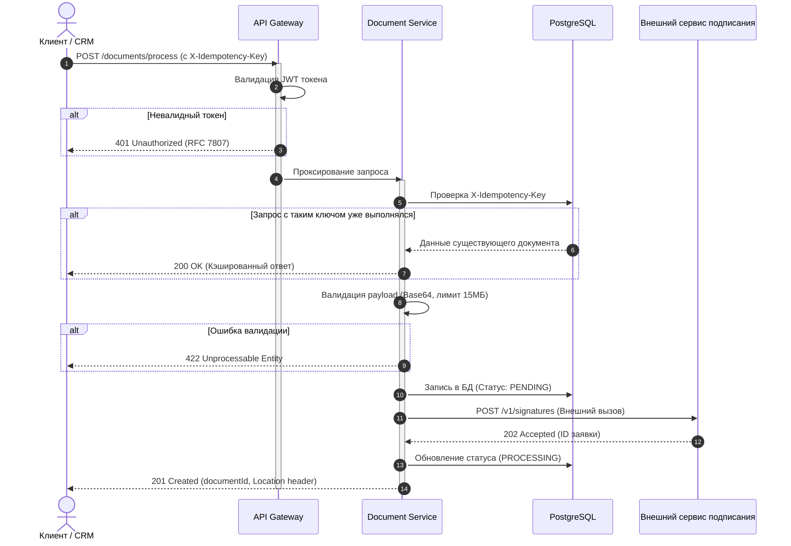

# Кейс 1: Спецификация REST API и межсервисная интеграция

## 📌 Бизнес-контекст
Сервис электронного документооборота банковской платформы. Смежным системам (CRM, фронтенд кредитного конвейера) требовался единый метод для первичной валидации документов, сохранения метаданных и постановки задач в очередь на факсимильное подписание.

## 🎯 Проблема
* Разработчики тратили до 5 часов в неделю на консультации смежных команд по структуре запросов.
* Документация в Confluence не отражала реальные коды ошибок, возникали сбои из-за превышения лимитов размера payload (Base64).

## 🛠 Что сделано
1. **Разработана спецификация [openapi.yaml](./openapi.yaml)** по стандарту OpenAPI 3.0.
2. **Внедрен стандарт RFC 7807 (Problem Details)** для унификации сообщений об ошибках (`400`, `401`, `422`).
3. **Задокументирован механизм идемпотентности** с использованием заголовка `X-Idempotency-Key` (UUIDv4) для предотвращения дублирования договоров при сетевых таймаутах (`504 Gateway Timeout`).
4. **Спроектирована Sequence-диаграмма** взаимодействия сервисов при обработке запроса.

---

## 🔄 Архитектура вызова (Sequence Diagram)

---

## 💡 Ключевые решения в контракте
* **Разделение валидации:** Техническая ошибка парсинга структуры возвращает `400 Bad Request`, а превышение лимита файла или неизвестный `docType` — `422 Unprocessable Entity` с массивом проблемных полей `invalidParams`.
* **Защита от сетевых сбоев:** Клиенту гарантируется безопасность повторного вызова с тем же UUID при получении `5xx` ошибок от сети.
