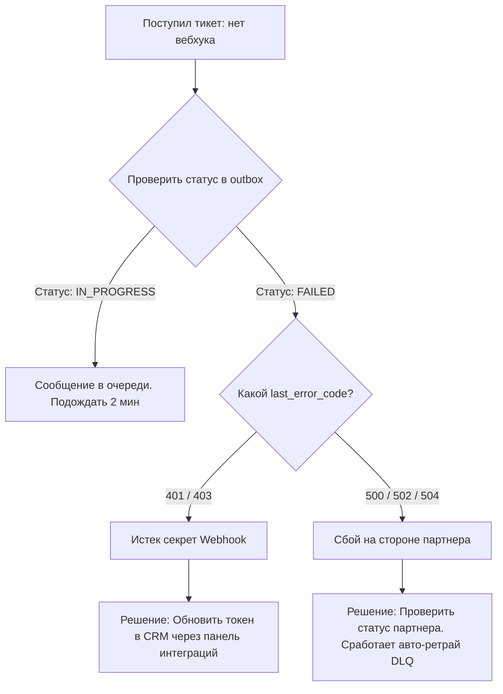

# Кейс 3: Runbook по локализации инцидентов (Troubleshooting Guide)

## 📌 О кейсе
При интеграции микросервисов с внешними CRM и чат-ботами периодически возникали сбои доставки Webhook-уведомлений. 
Из-за отсутствия четкого алгоритма 1-я линия техподдержки эскалировала 100% инцидентов напрямую разработчикам, отвлекая команду от продуктовых спринтов.

Был разработан **Runbook (пошаговый регламент расследования)**, который позволил саппорту самостоятельно локализовать проблему за 5 минут.

---

## 🛠 Алгоритм локализации инцидента

### Шаг 1. Анализ логов воркера отправки (Kubernetes / Grafana Loki)
При жалобе на недоставку события в CRM, дежурный специалист проверяет логи сервиса диспетчера:

```bash
kubectl logs -n integration -l app=webhook-dispatcher --tail=200 | grep -E "ERROR|TIMEOUT"
```

**Маркеры в логах:**
* `Connection refused` / `Timeout 504`: недоступен сервер принимающей стороны (внешняя CRM).
* `401 Unauthorized`: проблема с токеном или подписью вебхука.

---

### Шаг 2. Проверка состояния очереди в базе данных (PostgreSQL)
Все исходящие уведомления сохраняются в паттерне **Transactional Outbox**. Для поиска зависших или упавших в ошибку сообщений выполняется диагностический запрос:

```sql
SELECT 
    id,
    external_client_id,
    retry_count,
    last_error_code,
    last_attempt_at,
    payload->>'event_type' AS event_type
FROM integration_outbox
WHERE status = 'FAILED'
  AND last_attempt_at >= NOW() - INTERVAL '4 hours'
ORDER BY retry_count DESC
LIMIT 15;
```

---

### Шаг 3. Дерево решений (Decision Tree)



---

## 💡 Политика повторных попыток (Retry Policy)
В документации зафиксированы правила работы механизма ретраев:
* **Интервалы:** Экспоненциальный откат (Exponential Backoff) — `1 мин`, `5 мин`, `15 мин`, `1 час`.
* **Лимит:** Максимум `5 попыток`.
* **DLQ (Dead Letter Queue):** Если за 5 попыток партнер не ответил `200 OK`, сообщение переходит в терминальный статус `DEAD` и хранится 14 дней для ручного перезапуска.

---

## 📈 Результаты для бизнеса
* На **65% снизилось количество эскалаций** на бэкенд-разработчиков.
* Среднее время первичной диагностики тикета (MTTD) сократилось с 45 минут до **7 минут**.
